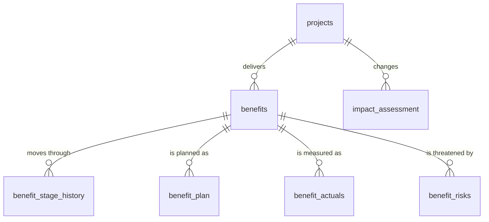
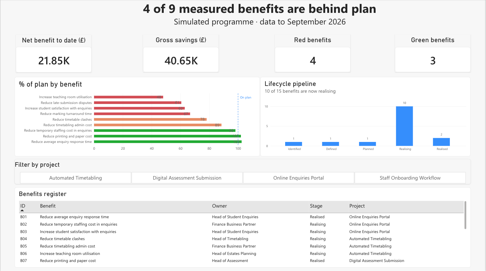
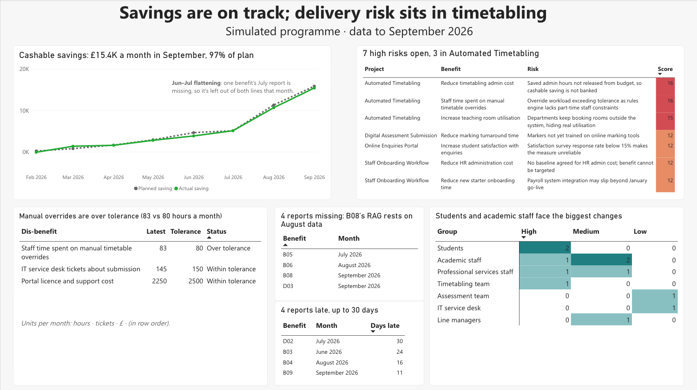

# Benefits Realisation Tracker

SQL and Power BI analysis of a simulated university transformation programme. It tracks whether four change projects are delivering the benefits they promised, from when each benefit is first identified through to full realisation, and highlights the trends, risks and data gaps a programme board needs to act on.

> **About the data:** all data is simulated for a fictional university. It is shaped like a real benefits register, including realistic data-quality problems.

## The business problem

Transformation programmes are approved on the benefits they promise, but benefits often arrive months after go-live, sit with different owners, and are reported inconsistently. A programme board needs one trusted view of three things: which benefits are on track, which risks and dis-benefits threaten them, and whether the data behind the view can be relied on.

## The programme

| Project | Go-live | Benefits | Dis-benefits |
| --- | --- | --- | --- |
| Online Enquiries Portal | Feb 2026 | 3 | 1 |
| Automated Timetabling | May 2026 | 3 | 1 |
| Digital Assessment Submission | Aug 2026 | 3 | 1 |
| Staff Onboarding Workflow | Jan 2027 (in delivery) | 3 | 0 |

## Data model

Seven tables: the benefits register, lifecycle stage history, monthly plan and actuals, risks, and an as-is → to-be impact assessment.

Full column definitions, table grain and known data-quality issues are in the [data dictionary](docs/data_dictionary.md).

## Questions answered

| # | Sponsor question | Query | Result |
| --- | --- | --- | --- |
| 01 | What stage of the lifecycle is each benefit at? | [sql](sql/01_benefits_register.sql) | [csv](results/01_benefits_register.csv) |
| 02 | How many benefits are at each lifecycle stage? | [sql](sql/02_lifecycle_pipeline.sql) | [csv](results/02_lifecycle_pipeline.csv) |
| 03 | How much of each benefit has been realised? | [sql](sql/03_realisation_to_date.sql) | [csv](results/03_realisation_to_date.csv) |
| 04 | Which benefits are on track against plan (RAG)? | [sql](sql/04_rag_status.sql) | [csv](results/04_rag_status.csv) |
| 05 | Which open risks most threaten benefits? | [sql](sql/05_sponsor_risk_view.sql) | [csv](results/05_sponsor_risk_view.csv) |
| 06 | Are cashable savings tracking to plan each month? | [sql](sql/06_cashable_savings_trend.sql) | [csv](results/06_cashable_savings_trend.csv) |
| 07 | What is the net cashable benefit after dis-benefit costs? | [sql](sql/07_net_cashable_benefit.sql) | [csv](results/07_net_cashable_benefit.csv) |
| 08 | Are any dis-benefits over tolerance? | [sql](sql/08_disbenefits_tolerance.sql) | [csv](results/08_disbenefits_tolerance.csv) |
| 09 | Where are benefit reports missing? | [sql](sql/09_missing_reports.sql) | [csv](results/09_missing_reports.csv) |
| 10 | Which reports were late, and by how much? | [sql](sql/10_late_reports.sql) | [csv](results/10_late_reports.csv) |
| 11 | Which stakeholder groups are most affected by the change? | [sql](sql/11_impact_assessment_summary.sql) | [csv](results/11_impact_assessment_summary.csv) |

## Key findings (data to September 2026)

1. **Efficiency benefits are landing; experience benefits are not.** Of 9 benefits being measured, 3 are Green, 2 Amber and 4 Red. All three quality benefits (student satisfaction, room utilisation, marking turnaround) are Red, at 48–67% of their planned trajectory.
2. **Cashable savings are close to plan.** September's monthly saving was £15,415 against a planned £15,855 (97%). Across February–September the programme saved £40,654 gross, or **£21,854 net** after £18,800 of new portal licence and support costs.
3. **One dis-benefit has breached tolerance.** Staff time on manual timetable overrides reached 83 hours a month against an agreed tolerance of 80, and is linked to one of the two highest-scoring open risks (16 out of 25).
4. **Risk is concentrated in Automated Timetabling.** It holds 3 of the 7 open high risks, including both risks scored 16.
5. **The reporting itself needs attention.** Four monthly reports are missing and four were late (by 11–30 days). One benefit still has no agreed target. The Red status for late-submission disputes rests on August data, because September's report is missing.

## Dashboard

Built in Power BI from the query results.

**Page 1: Programme overview**

**Page 2: Trends, risks and data quality**

## Recommendations

Prioritised by how far each benefit is behind plan and the risks attached. The full version is in the [sponsor report](report/sponsor_report.md).

1. **Timetabling recovery plan, by 31 December 2026:** bank the admin saving, fix the rules engine to bring overrides back under tolerance, and route all room bookings through the system.
2. **Unblock the quality benefits, by 31 January 2027:** train markers on online marking, and raise satisfaction survey response rates so the measure can be trusted.
3. **Strengthen benefits reporting:** chase missing reports by 10 December 2026, then agree a target for HR administration cost and add reminders and escalation for late reports by March 2027.

## How this was built

I designed the business questions and data model around how benefits are tracked in practice, and used Claude (an AI assistant) to help write and test the SQL. I've reviewed every query and can walk through its logic. The dashboard, findings and recommendations are my own work. I'm continuing to build my SQL skills alongside this project.

## How to reproduce

1. Install [DB Browser for SQLite](https://sqlitebrowser.org/) (free).
2. Create a new database and run [`sql/00_create_tables.sql`](sql/00_create_tables.sql).
3. Import each CSV in `data/` into the table with the same name (File → Import → Table from CSV file).
4. Run any query in `sql/`. Outputs should match the files in `results/`.

## Tools

SQL (SQLite) · Power BI · Excel

## About me

Gana Cariappa: analyst with a sports science background, based in London. I’ve built data models, benchmarks and Power BI reporting for multi-stakeholder programmes at the Premier League. MSc Human and Applied Physiology, King’s College London. [LinkedIn](https://www.linkedin.com/in/gana-cariappa/)
