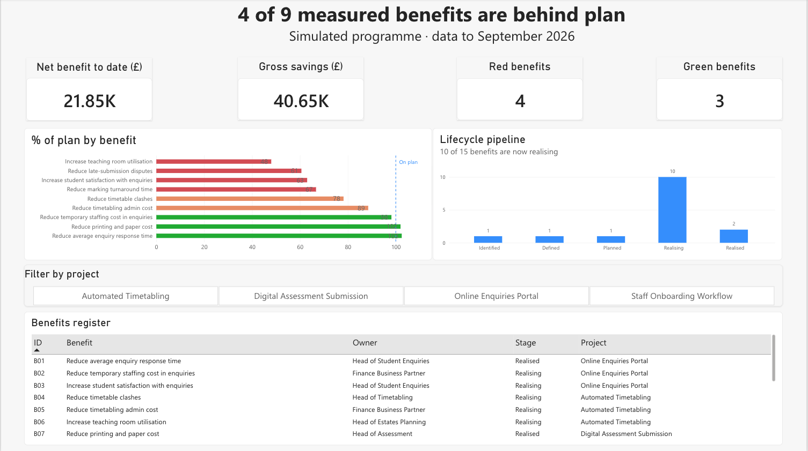
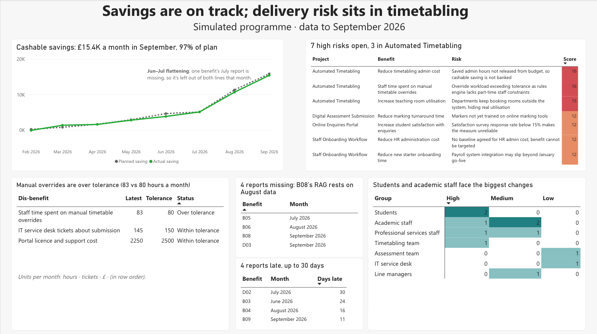

# Dashboard

A two-page Power BI report built on the query results in [`results/`](../results). Each visual's title states its finding, so a sponsor gets the message without reading the chart.

## Page 1: Programme overview

| Visual | Shows | Source |
| --- | --- | --- |
| Headline cards | Net benefit to date, gross savings, number of Red and Green benefits | Queries 07, 04 |
| % of plan by benefit | Each benefit's progress against its planned trajectory, coloured by RAG, with an "on plan" line at 100% | Query 04 |
| Lifecycle pipeline | Benefits at each stage, from Identified to Realised | Query 02 |
| Benefits register | Every benefit with its owner, stage and project, filterable by project | Query 01 |

## Page 2: Trends, risks and data quality

| Visual | Shows | Source |
| --- | --- | --- |
| Cashable savings trend | Planned vs actual monthly saving, annotated where a missing report affects the trend | Query 06 |
| High open risks | Open risks scored 12 or more, colour-coded by score | Query 05 |
| Dis-benefits vs tolerance | Latest value against the agreed tolerance | Query 08 |
| Data quality | Missing and late benefit reports | Queries 09, 10 |
| Change impact | As-is to to-be changes by stakeholder group and impact level, as a heat map | Query 11 |

## Design choices

- **Findings as titles** (e.g. "4 of 9 measured benefits are behind plan") rather than topic labels.
- **RAG colours reserved for status.** Everything else stays neutral, so red always means "act".
- **One fixed colour scale for the impact heat map**, so the same shade means the same count in every column.
- **Data caveats shown on the page,** next to the visuals they affect, rather than hidden in notes.
