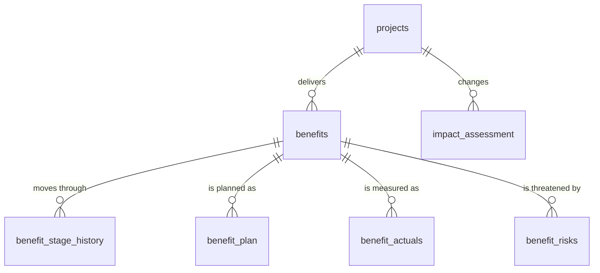

# Data dictionary and data map

All data is **simulated** for a fictional university's Student Services Transformation Programme. It is shaped like a real benefits register, including realistic data-quality problems.

## Data map

`benefit_plan` and `benefit_actuals` share a key (`benefit_id` + `period_month`). That shared key is what lets you compare planned against actual for the same benefit and month.

## Tables

### projects
One row per project in the programme.

| Column | Type | Description |
| --- | --- | --- |
| project_id | text, key | Project code, P1 to P4 |
| project_name | text | Project name |
| senior_sponsor | text | Senior Responsible Owner for the project's benefits |
| project_manager | text | Delivery lead |
| start_date | date | Project initiation |
| go_live_date | date | When the change went live; benefits start being measured from this month |
| delivery_status | text | `Live` or `In delivery` |

### benefits
The benefits register: one row per benefit or dis-benefit.

| Column | Type | Description |
| --- | --- | --- |
| benefit_id | text, key | B = benefit, D = dis-benefit |
| project_id | text → projects | The project that enables the benefit |
| benefit_name | text | What should change |
| benefit_type | text | `Cashable` (money released from budget), `Non-cashable` (time or effort saved), `Quality` (experience or outcome) |
| is_disbenefit | 0 / 1 | 1 = a negative consequence of the change |
| benefit_owner | text | Who is accountable for realising and reporting it |
| unit | text | Unit of measure |
| desired_direction | text | `Increase` or `Decrease` |
| baseline_value | number | Value before the change |
| target_value | number | Target for benefits. **For dis-benefits, this is the tolerance**: the most that is acceptable. |
| target_date | date | When the target should be reached |

### benefit_stage_history
One row per benefit per lifecycle stage reached. The latest row is the benefit's current stage.

| Column | Type | Description |
| --- | --- | --- |
| benefit_id | text → benefits | |
| stage | text | `Identified` → `Defined` → `Planned` → `Realising` → `Realised` |
| stage_date | date | When the benefit reached the stage |
| recorded_by | text | Who recorded it |

### benefit_plan
The planned trajectory: one row per benefit per month.

| Column | Type | Description |
| --- | --- | --- |
| benefit_id | text → benefits | |
| period_month | date | First day of the month |
| planned_value | number | Planned value for that month |

### benefit_actuals
Measured values: one row per benefit per month reported.

| Column | Type | Description |
| --- | --- | --- |
| benefit_id | text → benefits | |
| period_month | date | First day of the month measured |
| actual_value | number | Measured value |
| reported_date | date | When it was reported. Reports are due by the 10th of the following month. |

### benefit_risks
One row per risk to a benefit.

| Column | Type | Description |
| --- | --- | --- |
| risk_id | text, key | |
| benefit_id | text → benefits | The benefit at risk |
| raised_date | date | |
| risk_description | text | |
| likelihood | 1–5 | |
| impact | 1–5 | Risk score = likelihood × impact; 12 or more is high |
| risk_status | text | `Open` or `Closed` |
| risk_owner | text | |

### impact_assessment
One row per as-is → to-be change, used for business impact assessment.

| Column | Type | Description |
| --- | --- | --- |
| impact_id | text, key | |
| project_id | text → projects | |
| change_area | text | `Process`, `System`, `Structure` or `Stakeholder` |
| as_is | text | How it works now |
| to_be | text | How it will work |
| impacted_group | text | Who is affected |
| impact_level | text | `High`, `Medium` or `Low` |

## Known data-quality issues (deliberate)

| Issue | Where | How the analysis handles it |
| --- | --- | --- |
| Missing monthly reports | benefit_actuals | Found by comparing against the plan (query 09) and flagged to benefit owners |
| Late reports | benefit_actuals | Measured against the 10th-of-month deadline (query 10) |
| No target set | benefits B12 | Excluded from realisation measures and raised as a risk (R09) |
| Inconsistent owner name casing | benefits B12 | Standardise with `LOWER()` or `UPPER()` before grouping by owner |
| Latest reported month differs by benefit | benefit_actuals | Each benefit is measured at its own latest month, not a single programme date |
